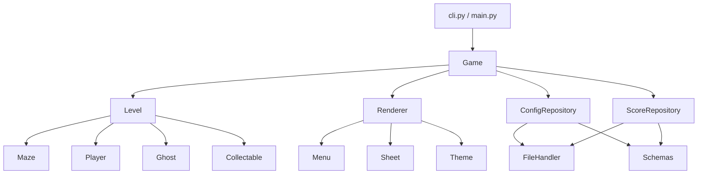

*This project has been created as part of the 42 curriculum by gvan-box, bmaassen.*

# Pac-Man

A faithful-as-possible re-creation of the 1980 Pac-Man arcade game in Python, built with pygame-ce. Mazes are generated procedurally, the player moves through 256 levels against four ghosts, and a persistent top-10 highscore table is kept between sessions.

## Description

The goal of the project is to build a playable Pac-Man that stays as close as possible to the original arcade cabinet: pixel-stepped grid movement, four ghosts with distinct chase behaviours, power pellets, lives, a level progression with shrinking ghost timers, a "42" pattern in every maze, and an arcade-style highscore entry.

Main features:

- Procedurally generated mazes (one per level, deterministic per seed) using the assigned `mazegenerator` package.
- Four ghosts (Blinky, Pinky, Inky, Clyde) with distinct targeting rules.
- Power pellets, pellets, lives, level timer and score.
- Pydantic-validated JSON configuration with comment support and graceful fallback to defaults.
- Persistent top-10 highscore table with backup on corruption.
- Menu, instructions, pause, level-up, game-over, completion and highscore screens.
- Cheat mode for testing and demonstration.
- One-file PyInstaller build for distribution.

## Instructions

### Prerequisites

- Python 3.13 or newer
- [uv](https://docs.astral.sh/uv/)

### Make targets

| Target | Action |
|---|---|
| `make install` | Install dependencies (`uv sync`) |
| `make run` | Run the game with `config/config.json` |
| `make test` | Run the test suite (`pytest -vv tests/`) |
| `make lint` | Run flake8 and mypy on `src/` |
| `make clean` | Remove the virtual environment and caches |
| `make build` | Build the one-file executable with PyInstaller (`dist/pac-man`) |

### Usage

```bash
python3 pac-man.py config/config.json
```

The configuration file is the only argument. When running the frozen executable without an argument, the bundled default configuration is used. The process exits with a non-zero code on fatal errors.

### Controls

| Key | Action |
|---|---|
| Arrow keys | Move Pac-Man / navigate menus |
| Enter | Confirm |
| Escape | Pause (while playing) |
| Backslash (`\`) | Open the cheat prompt (while playing) |

Further per-screen keys are listed on the in-game instructions screen.

### Packaging

`make build` runs `pyinstaller pac-man.spec`, bundling `assets/images`, `assets/audio` and `config/config.json` into a single executable.

## Configuration

The configuration file is JSON. Lines starting with `#` in column 0 are treated as comments and ignored.

```json
# Pac-Man configuration
{
  "width": 40,
  "height": 40,
  "lives": 3,
  "seed": 42,
  "level_max_time": 120,
  "ghost_speed_multiplier": 1.0
}
```

| Key | Default | Notes |
|---|---|---|
| `width` | 19 | Maze width in cells |
| `height` | 22 | Maze height in cells |
| `lives` | 3 | Starting lives |
| `seed` | 42 | Base seed; level seed = `seed + level_index` |
| `level_max_time` | 120 | Seconds per level (minimum 90) |
| `ghost_speed_multiplier` | 1.0 | Scales ghost speed |

Invalid values are clamped to their defaults by the validators. Problems (missing file, bad JSON, out-of-range values) are collected as warnings and shown on a warning screen instead of crashing the game.

## Highscore

Scores are stored in `high_scores.json` inside the SDL preference directory (`pygame.system.get_pref_path`), so they persist per user and are independent of the install location or of a read-only bundled executable.

- Top 10 entries, sorted by score.
- Names are three letters, upper-cased, arcade style.
- Timestamp format `YYYYMMDD`.
- If the file is corrupt, it is moved to a `.bak` backup and a fresh table is started, and a warning is shown.

Validation goes through Pydantic schemas (`ScoreEntry`, `ScoreSchema`), and the `ScoreRepository` returns `(result, warning)` tuples so the UI can report problems without exceptions crossing layers.

## Maze Generation

Mazes come from the provided `mazegenerator` wheel (`libs/mazegenerator-2.0.2-py3-none-any.whl`, referenced through `[tool.uv.sources]` in `pyproject.toml`). It is used unmodified:

```python
MazeGenerator(size=(width, height), seed=level_seed)
```

The `Maze` class in `src/core/maze.py` adapts the generator output to the game: it converts cells to `(row, col)` coordinates, stores walls as a bitmask (N=1, E=2, S=4, W=8), keeps the "42" cells closed, determines the spawn positions and fills about 35% of the open cells with pellets. The seed per level is `seed + level_index`, so mazes are reproducible.

## Cheat Mode

Press backslash while playing and type one of the following:

| Cheat | Effect |
|---|---|
| `kill 'm all!` | Eliminate the ghosts |
| `meep meep...` | Speed boost |
| `me hungry` | Collect all pellets at once |
| `let's cherry pick` | Change al normal pellets to bonus pellets |
| `i'm bored` | Fast forward to last level |
| `clear` | Clear all cheats |

## Implementation

- **Movement:** per-frame pixel steps (player: tile // 15, ghosts: tile // 20 times the multiplier). Turns are accepted inside a window of `speed / 2` around the cell centre, after which the actor is snapped to the centre. Reversal is allowed anywhere.
- **Ghost AI:** greedy one-cell target chasing. Blinky targets Pac-Man directly, Pinky four cells ahead, Inky uses a vector-based target from Blinky's position, Clyde chases when far and moves randomly when close. A BFS is used for retreat.
- **Timers:** ghost timers shrink with level (`7 - idx // 5` and `9 - idx // 5`, clamped to 3–7 and 5–9 seconds).
- **Levels:** 256 levels in total.
- **Rendering:** each frame builds a frozen `RenderContext` that the `Renderer` draws, keeping game logic and drawing separated.

## General Software Architecture



| Package | Contents |
|---|---|
| `src/models` | Enums, `RenderContext`, Pydantic schemas |
| `src/storage` | `FileHandler`, `ConfigRepository`, `ScoreRepository` |
| `src/core` | `Game` state machine, `Level`, `Maze`, `Actor`/`Player`/`Ghost`, `Collectable` |
| `src/ui` | `Renderer`, menu classes, sprite sheet, theme |

`Game` is a state machine with the states START, ACTIVE, INSTRUCTIONS, LEVELUP, PAUSE, COMPLETED, GAMEOVER, ENTER_HIGHSCORE, DISPLAY_HIGHSCORE, WARNING, CHEATS and QUIT. A detailed, as-is description of every module is kept in the project's `docs/handshake.md`.

## Project Management

We worked issue-first on GitHub: every change starts as an issue, is developed on a feature branch and merged via a pull request that meets the Definition of Done. Conventional commits are used. A weekly sync takes place on Mondays at 11:00. Progress is tracked on a GitHub Projects Kanban board.

The project repository also contains a `management/` directory (workflow manual and decision log), `TDD.md`, `docs/git-workflow.md` and `docs/testing.md`.

## Known Limitations

- No sound is played.

## Resources

- [The Pac-Man Dossier](https://pacman.holenet.info/)
- [pygame-ce documentation](https://pyga.me/docs/)
- [Pydantic](https://docs.pydantic.dev/)
- [uv](https://docs.astral.sh/uv/)
- [PyInstaller](https://pyinstaller.org/)
- [mypy](https://mypy.readthedocs.io/), [flake8](https://flake8.pycqa.org/), [pytest](https://docs.pytest.org/)
- [PEP 257](https://peps.python.org/pep-0257/), [Conventional Commits](https://www.conventionalcommits.org/)

### Use of AI

Claude was used for drafting and consistency-checking documentation (handshake and this README), writing pull-request descriptions, explaining concepts and giving code-review feedback. All AI output was reviewed and adjusted by the authors, who remain responsible for the code and documents.
